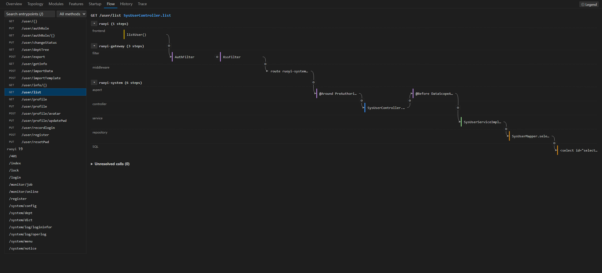
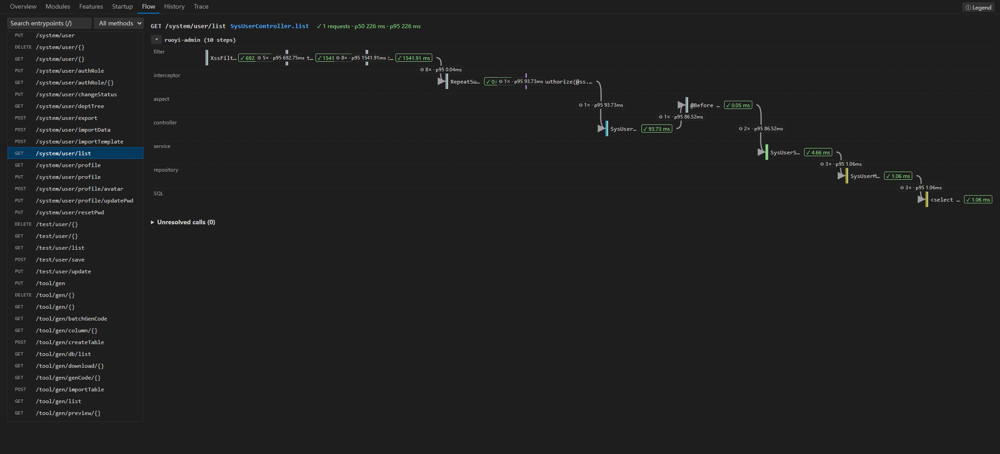
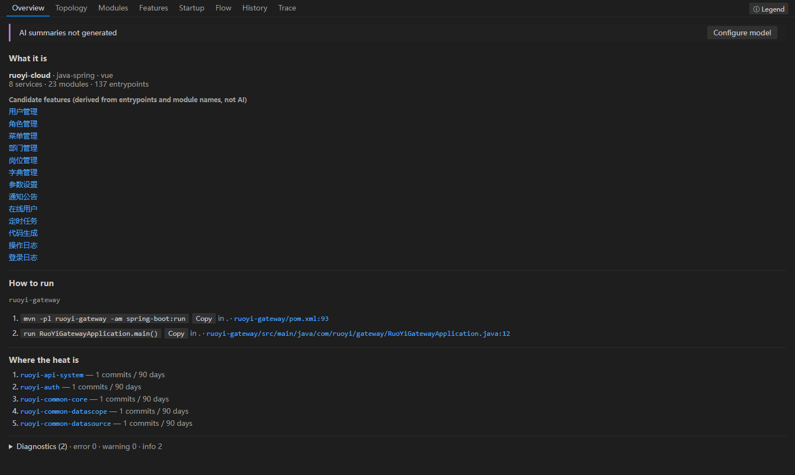
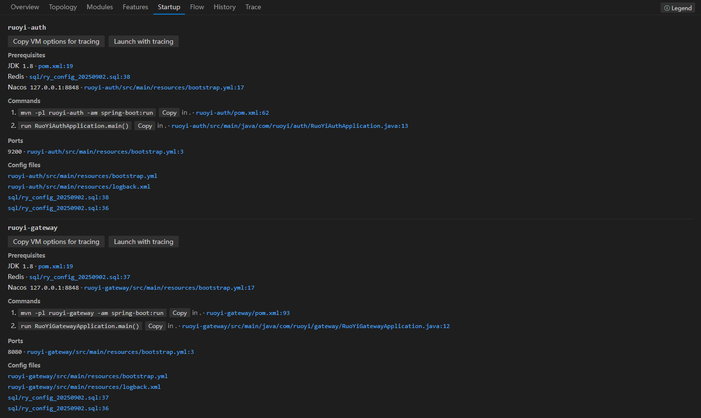

# ProjectAtlas

**[中文](README.zh-CN.md)** · English

[](https://github.com/a805034104/project-atlas/actions/workflows/ci.yml)
[](https://github.com/a805034104/project-atlas/releases)
[](LICENSE)

**A map of your Spring / Vue / RuoYi project, inside VS Code.** Open the repository, click *Analyze*, and within a minute you can follow any request from the Vue page through the gateway, filters, interceptors, aspects, controller, service and mapper down to the SQL statement. Every step links to the file and line it came from.



<sub>Real output for [RuoYi-Cloud](https://gitee.com/y_project/RuoYi-Cloud): `GET /system/user/list`, from the Vue page `listUser()`, through the gateway `AuthFilter` / `XssFilter` and route, `@PreAuthorize`, `SysUserController.list`, the `@DataScope` aspect and `SysUserServiceImpl`, down to the mapper XML `<select>`.</sub>

## Why

Joining a large Spring Cloud codebase usually means a week of reading code to answer simple questions: which filters run before this endpoint, which service does this page call, and what writes to this table? Generic code search doesn't know about Spring Security filter order, Ant patterns in `HandlerInterceptor`s, AspectJ pointcuts, gateway `StripPrefix`, Feign clients or MyBatis XML. ProjectAtlas does.

- **Rules first, AI optional.** Every solid edge is derived from code and framework semantics. When the analyzer cannot tell which method runs (an interface with several beans, an overload the arguments don't decide, a dynamic topic), it draws nothing and lists the call under *Unresolved*. AI-inferred edges are dashed and labelled.
- **Runtime confirms the static map.** Start a service with the OpenTelemetry javaagent and the map marks what actually ran, with call counts and p95 latency.
- **Local by default.** Analysis runs on your machine. No telemetry. AI is off until you configure a key, and even then you see a cost estimate before anything is sent.

## Features

| | |
|---|---|
| **Request flows** | Frontend call → dev proxy → Spring Cloud Gateway (routes, `StripPrefix`/`RewritePath`, global filters) → servlet filters in Spring Security order → `HandlerInterceptor`s (Ant include/exclude) → `@PreAuthorize` → AspectJ advice → controller → service (DI with `@Primary`, `@Qualifier`, `@Resource`; several implementations shown as branches) → MyBatis mapper XML / MyBatis-Plus → SQL |
| **Cross-service links** | Frontend → gateway → service, OpenFeign, RestTemplate / WebClient with `lb://`, and message queues: Kafka, RabbitMQ (direct / topic / fanout / default exchange, dead-letter TTL queues), RocketMQ tags, Redis Stream, Spring Cloud Stream |
| **Runtime reconciliation** | Pinned OpenTelemetry javaagent 2.31.1 (sha256-checked). Steps, edges and links observed at runtime with count · p95 · errors; a Trace tab with a waterfall; calls seen only at runtime are listed, never drawn as guesses |
| **Startup guide** | Prerequisites (JDK, MySQL, Redis, Nacos…), build and run commands, ports, each with the file and line it comes from |
| **Modules & history** | Maven modules, Spring Boot apps (`spring.application.name`, Nacos configs exported as SQL), Vue apps; per-module git history |
| **Optional AI** | Module summaries and a feature list from Anthropic, any OpenAI-compatible API (DeepSeek, Qwen…) or a local Ollama. Keys live in VS Code SecretStorage; `.env`/keys are never sent and secrets in files are masked |
| **CLI & MCP** | `project-atlas analyze` / `show` / `trace` for terminals and CI; a read-only MCP server so coding agents query verified call chains instead of guessing them |



<sub>Runtime overlay from a real RuoYi-Vue run: each step and edge shows how often it ran and its p95.</sub>

<table><tr>
<td></td>
<td></td>
</tr><tr>
<td align="center"><sub>Overview: services, modules, entrypoints, how to run</sub></td>
<td align="center"><sub>Startup guide with sources</sub></td>
</tr></table>

## Install

ProjectAtlas is not on the Marketplace yet.

1. Download `project-atlas-<version>.vsix` from [Releases](https://github.com/a805034104/project-atlas/releases).
2. In VS Code: *Extensions* ▸ `…` ▸ *Install from VSIX…* (or `code --install-extension project-atlas-0.2.1.vsix`).
3. Open a Spring / Vue project and run **Atlas: Analyze** (status bar or command palette). No key is needed.

Requires VS Code 1.95+. Runtime tracing also needs a JDK 8+ for your own application.

### From source

```bash
git clone https://github.com/a805034104/project-atlas.git
cd project-atlas
npm ci && npm run build          # Node.js 20+
npx vitest run                   # optional: the test suite
node packages/cli/dist/bin.js analyze /path/to/your/project --no-ai
```

Press F5 in VS Code with `packages/vscode` open to run the extension in a development host.

## Usage

**In VS Code** — *Atlas: Analyze*, then browse the tabs: Overview, Topology, Modules, Features, Startup, Flow, History, Trace. CodeLens on controller methods opens the flow of that endpoint. *Export HTML* writes a single offline file you can share.

**CLI**

```bash
project-atlas analyze . --no-ai --markdown ATLAS.md     # analyze, write a Markdown map
project-atlas show "GET /system/user/list"              # print one flow in the terminal
project-atlas trace -- mvn spring-boot:run              # run with the javaagent, print what was observed
project-atlas trace --print-config                      # VM options to paste into IDEA
```

(From a source checkout, `project-atlas` is `node packages/cli/dist/bin.js`.)

**MCP** — `atlas-mcp --dir .atlas` serves entrypoints, flows, service links and runtime aggregates (never span attribute values) to coding agents over stdio.

**Runtime tracing** — paste the VM options from *Atlas: Copy VM Options for Tracing* into your IDE run configuration, restart, send a request. Spans go to a receiver on 127.0.0.1 only; SQL text, bodies and headers are never stored. See [docs/runtime-tracing.md](docs/runtime-tracing.md).

## Supported

| Area | Supported |
|---|---|
| Java | Spring MVC / Boot 2–3: mapping annotations (constants and `${}` resolved), filters (`FilterRegistrationBean` url patterns), interceptors, `@PreAuthorize`/`@Secured`, AspectJ (`execution`, `within`, `@annotation`, `bean`…), DI incl. Lombok constructors, MyBatis XML, MyBatis-Plus `BaseMapper`, `@Scheduled` |
| Spring Cloud | Gateway routes and filters, Nacos config from SQL dumps (shared/extension configs, profiles), OpenFeign, RestTemplate / WebClient |
| Vue | Vue 2/3, `src/api` request helpers, pages, router tables, RuoYi `sys_menu` routes, Vite / Vue CLI dev proxy |
| Message queues | Kafka, RabbitMQ, RocketMQ, Redis Stream, Spring Cloud Stream; unresolvable destinations are listed, never guessed |
| Runtime (Java) | Filters, interceptors, aspects, controllers, services, MyBatis mappers, SQL; HTTP/Feign, Kafka, RabbitMQ, RocketMQ and Redis Stream links confirmed at runtime |
| Tested on | RuoYi-Vue, RuoYi-Cloud (+ Vue 3), pig, JeecgBoot, mall-swarm |
| Next | Go + gRPC, Python + Dubbo, SkyWalking / Arthas trace import |

## How it works

tree-sitter (WASM) parses Java, JS/TS and Vue into per-file facts (cached by content hash). Framework rules turn facts into a graph of steps and edges with stable IDs; per-entrypoint flows are projections over that graph. The runtime side is an OTLP receiver plus a reconciler that maps spans onto steps without changing the saved graph. Details: [docs/architecture.md](docs/architecture.md).

## Contributing

Bug reports with a minimal reproduction (or a link to a public repository) are the most useful thing you can send. Adding a framework rule is described in [CONTRIBUTING.md](CONTRIBUTING.md); every rule ships with a fixture and a test. Please report security issues privately, see [SECURITY.md](SECURITY.md).

## Docs

[Runtime tracing](docs/runtime-tracing.md) · [Errors](docs/errors.md) · [Architecture](docs/architecture.md) · [Changelog](CHANGELOG.md) · [Spec](docs/spec.md) · [v0.2 spec](docs/spec-v0.2.md)

## License

[MIT](LICENSE)
